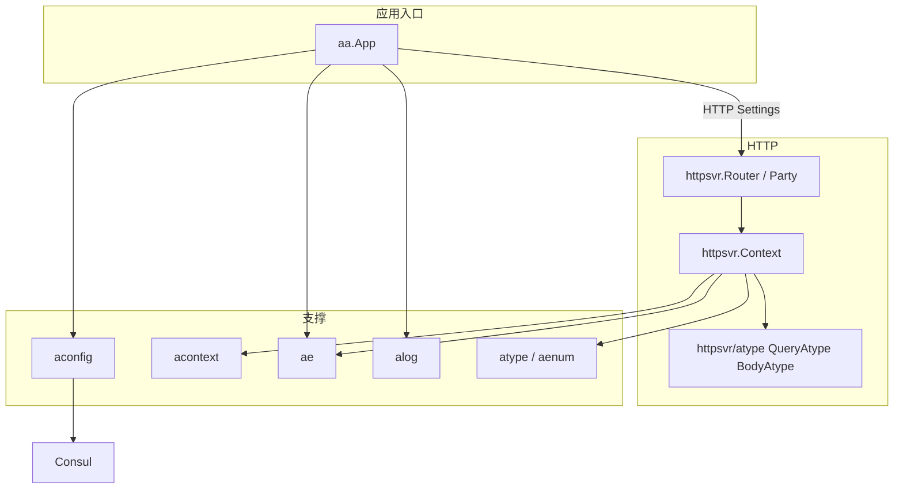
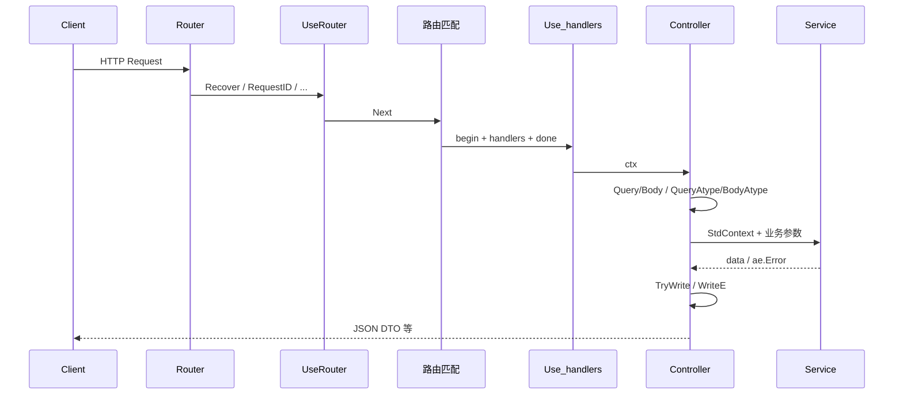
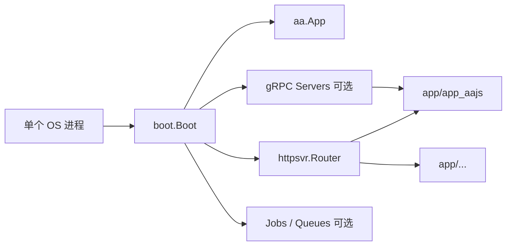
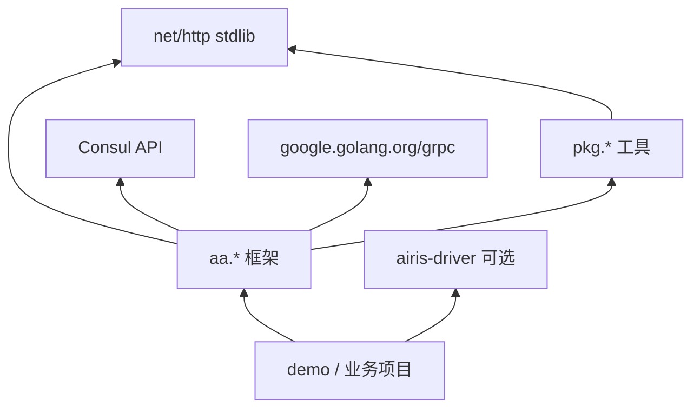

# Airis

Airis 是基于 Go 标准库 `net/http` 的应用框架，其主要价值在于实现一种像 PHP 一样方便的 Controller 层，并且能在微服务项目初期，使用一个进程就能方便启动和管理多个 gRPC 微服务和 HTTP server 服务。

Airis aconfig 里面默认使用 Consul 进行服务注册和服务发现，并且推荐将 Redis 和 MongoDB 作为基础数据源。

如果用户不想使用 MongoDB ，可以自行生成文件夹，或忽略通过 `airis-tool` 脚手架 `./cmd/cmd new <app 名称>` 生成的代码 mongodb 部分即可。

同时 Airis Driver 项目（[https://github.com/aarioai/airis-driver](https://github.com/aarioai/airis-driver)），也提供了 MongoDB、MySQL、RabbitMQ、Redis 等驱动方法，方便开发者快捷操作。脚手架与 Demo 见独立仓库 [airis-tool](https://github.com/aarioai/airis-tool)。

## Demo 入门示例说明

Demo 代码请参考 `airis-tool/demo` 目录。

project 目录下，放了3个示例项目：
* tutorial  生成代码目录前的项目初始化状态
* simple 纯 HTTP Server 服务的项目
* microservice 同时提供 gRPC 微服务和 HTTP Server 服务的项目

项目名称，应根据业务需求具体命名。项目内，可以设置不同的 APP。APP 本质上也是一种 service，是可以对外开放的 service。

因此项目目录下 `/app/` 目录可以根据业务大小、关联度，设置不同的子服务，这些子服务统一由一个进程启动，这样在各微服务简单的时候，可以大幅度减少启动和运维成本。

后期，如果某个微服务重要度增加并已经趋于稳定，则可以直接将该 `/app/xxx` 单独部署为独立进程启动的微服务。


## 错误码以状态码形式输出

如果需要服务端将错误码以 http 状态码形式输出，可以有3种方法。部分运维工具检测健康状态通过 http 状态码，除这些健康状态接口外，其他接口不建议后端程序员直接抛出 http 状态码。为了方便快速定位服务端错误位置，服务端错误应该通过 http 状态码 200，并以 response body 的 error code/message 形式抛出。

> 注意：服务端不抛出 http 状态码，并不意味着客户端不用处理 http 状态码错误。服务端前面经过网关层、k8s 等层会被拦截而带上服务端或客户端错误相关的 http 状态码。
>> 建议将 API 以 http 状态码输出错误，还是以 body code 方式输出错误的选择权交给客户端决定

1. 客户端在 header 加 `X-Error-As-Status=true` ，服务端不用任何操作，这样服务端报错将以 http 状态码形式报错
2. 客户端在 URL 参数加 `x-error-as-status=true`，服务端不用任何操作，这样服务端报错将以 http 状态码形式报错
3. 服务端在 Context 上指定 `ctx.ErrorAsStatus=true`，客户端不用任何操作，服务端报错将以 http 状态码形式报错

## Airis 架构说明

Airis（`github.com/aarioai/airis`）是基于 Go 标准库 `net/http` 的应用框架，提供接近 PHP 风格的 Controller 层，并支持在**同一进程**内管理多个 HTTP / gRPC 服务，便于微服务早期低成本演进。

配套驱动见 [airis-driver](https://github.com/aarioai/airis-driver)（MongoDB、MySQL、RabbitMQ、Redis 等）。

---

## 1. 设计目标

| 目标 | 说明 |
|------|------|
| 标准库优先 | HTTP 栈不依赖 Iris 等第三方 Web 框架 |
| Controller 友好 | 请求解析、DTO 写出、错误码统一挂在 `*httpsvr.Context` |
| 多 App 同进程 | 一个进程启动多个业务 App，成熟后再拆独立进程 |
| 配置与发现 | `aconfig` + Consul 服务注册 / 发现 |
| 类型安全参数 | `atype` 业务类型 + `httpsvr/atype` 参数解析命名空间 |

---

## 2. 仓库布局

```
airis/
├── aa/                 # 框架核心（本模块主要代码）
├── pkg/                # 通用工具库（无业务状态）
├── airis-tool/
│   ├── cmd/            # 脚手架与构建脚本（new project / app）
│   └── demo/project/   # 示例：tutorial / simple / microservice
├── go.mod
├── README.md
├── README_中文.md
```

业务项目由 `cmd` 生成，典型结构：

```
project/
├── main.go
├── boot/               # 启动、注册 HTTP Settings、自检
├── config/             # yaml 等配置
├── router/             # Party、中间件、路由注册
├── app/<name>/         # 业务 App（可多开）
│   ├── module/*/controller|service|model
│   ├── grpc/           # 可选 gRPC
│   └── job/            # 可选队列 / 定时任务
├── sdk/                # 对外客户端封装
└── proto/              # protobuf
```

---

## 3. 核心包一览（`aa/`）



| 包 | 职责 |
|----|------|
| [`aa`](aa/app.go) | `App`：Config / Log / HTTP Settings / 全局 Context |
| [`aa/httpsvr`](aa/httpsvr) | 路由、中间件、`Context`、请求解析、DTO 响应 |
| [`aa/httpsvr/atype`](aa/httpsvr/atype) | `ctx.QueryAtype` / `ctx.BodyAtype`（atype / aenum 参数） |
| [`aa/aconfig`](aa/aconfig) | yaml 配置、环境、Consul 解析与 gRPC resolver |
| [`aa/acontext`](aa/acontext) | 请求级 std context 绑定、IP、值袋键约定 |
| [`aa/ae`](aa/ae) | 业务错误码与 `*ae.Error` |
| [`aa/alog`](aa/alog) | 日志接口与默认实现 |
| [`aa/atype`](aa/atype) | 金额、日期、路径、区划等业务类型 |
| [`aa/aenum`](aa/aenum) / [`aa/atype/aenum`](aa/atype/aenum) | 枚举（文件类型、国家、性别、状态等） |
| [`aa/helpers/debug`](aa/helpers/debug) | 调试日志、profile |

`pkg/` 提供无框架状态的工具：`afmt`、`types`、`arrmap`、`httpc`、`nets`、`utils`、`ios` 等。

---

## 4. HTTP 架构（`httpsvr`）

### 4.1 组件

- **Router / Party**：对齐 Iris 风格的 `UseRouter` / `Use` / `Done` / `Party` / 多 handler
- **Context**：单次请求的全部能力（路径参数、Values、解析、写出、中间件链）
- **Settings**：经 `Router.UseHooks(app.HTTP)` 注入，控制 Content-Type、序列化、错误处理

### 4.2 中间件顺序

```
UseRouter…（匹配前，含 404/405）
    → Use…（匹配成功后的链首）
    → 路由 handlers…
    → Done…（需各 handler 调用 Next）
```

| API | 时机 |
|-----|------|
| `UseRouter` | 路由匹配之前，始终执行（Recover / RequestID / AccessLog / CORS） |
| `Use` / `Party(..., mw)` | 匹配成功后的 begin 中间件 |
| `Done` | 链尾；前面的 handler 须 `Next()` |
| `StopExecution` | 跳过后续（含 Done） |

### 4.3 请求处理链路



### 4.4 Controller 用法

```go
func (c *Controller) GetUser(ctx *httpsvr.Context) {
    defer ctx.Next()
    uid, e0 := ctx.QueryUint64("uid")
    if e := ctx.FirstError(e0); e != nil {
        return
    }
    ctx.TryWrite(c.s.User(ctx.StdContext(), uid))
}
```

参数分层：

| 能力 | 位置 | 示例 |
|------|------|------|
| 常用类型 | `Context` 方法 | `QueryUint64`、`BodyString`、`BodyAnyMap` |
| atype / aenum | `ctx.QueryAtype` / `ctx.BodyAtype` | `QueryAtype.Sex`、`BodyAtype.AudioPaths` |
| DTO 写出 | `Context` 方法 | `TryWrite`、`WriteE`、`WriteData`、`WriteOK` |
| std context | `StdContext()` | 传入 Service / 仓储 |

文件组织（同属 `package httpsvr`，atype 为子包）：

```
aa/httpsvr/
├── router.go / context.go / middleware.go / cors.go
├── request_*.go          # 常用 Query/Body
├── response_*.go         # Settings、DTO 写出、装饰器
└── atype/                # QueryAtype / BodyAtype 实现
    ├── query.go
    ├── body.go
    └── source.go         # 对 Context 的接口依赖，避免循环引用
```

### 4.5 响应约定

默认 JSON Body：

```json
{ "code": 0, "msg": "OK", "data": ... }
```

- `app.HTTP`（`*httpsvr.Settings`）可配置 `ServeContentTypes`、`ErrorHandler`、`BeforeSerialize`、`Serialize`
- `WriteData` 写出成功 DTO；`Write([]byte)` 仍为原始字节写出

---

## 5. 应用与多服务模型



- **项目**：部署与配置的边界（如 `airis-tool/demo/project/simple`）
- **App**：项目内可对外的业务单元（`/app/<name>`），可含 HTTP module、gRPC、job
- **演进**：初期同进程；某 App 稳定后可单独拆进程部署

配置默认走 Consul 注册发现；本地可用 `config/app-local.yaml`。数据层推荐 Redis / MongoDB（可不使用 Mongo，忽略生成代码即可）。

---

## 6. 支撑子系统

### 6.1 配置 `aconfig`

- 解析 yaml、环境变量
- Consul 客户端与 gRPC `resolver`（`aconfig/consul`）

### 6.2 错误 `ae`

- 统一业务错误：`Code` / `Msg` / 调用栈
- 与 HTTP DTO、`App.Check`、日志联动

### 6.3 上下文 `acontext`

- `Bind(*httpsvr.Context)` → `StdContext()`
- ClientIP、RequestID 等键约定
- `RequestCarrier` 接口避免 `acontext` 依赖路由包

### 6.4 类型 `atype`

- 领域类型：Money、Decimal、Date、路径（Image/Audio/Video）、Distri 等
- 由 `httpsvr/atype` 在 HTTP 边界做解析，业务层只消费强类型

---

## 7. 示例与脚手架

| 路径 | 说明 |
|------|------|
| `airis-tool/demo/project/tutorial` | 生成前的初始化态 |
| `airis-tool/demo/project/simple` | 纯 HTTP（可含示例 gRPC 代码） |
| `airis-tool/demo/project/microservice` | HTTP + 多 App gRPC |
| `airis-tool/cmd/project` | `new` 项目 / App 的模板与脚本 |

路由说明见各 demo 下 `router/README.md` 与 `router/README_路由说明.md`。

---

## 8. 依赖边界（简图）



原则：

- 业务代码依赖 `aa` 与可选 `airis-driver`，不反向依赖 demo
- `httpsvr/atype` 只依赖 `Context` 的基础 Query/Body 接口，不反向依赖路由实现细节
- `pkg` 保持无全局状态，可被 `aa` 与业务共用

---

## 9. 相关文档

- [README_中文.md](README_中文.md) — 简介与 Demo 说明
- [aa/httpsvr/README.md](aa/httpsvr/README.md) — 路由压测与压力测试
- [cmd/README_说明.md](airis-tool/cmd/README_说明.md) — 脚手架用法
- 各项目 `router/README*.md` — UseRouter / Use / Done 约定
